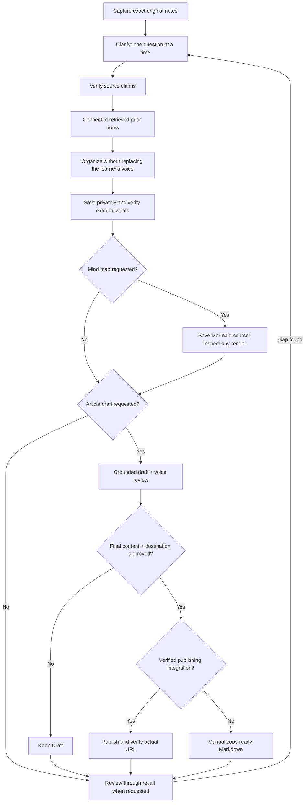

# LearningOS

**A Hermes Agent skill for learning in your own words.**

Capture an idea, work through confusion, verify what the source actually says, and connect it to earlier learning. Make a mind map or draft an article only when you ask. Keep the learner's original voice intact.

Created by **Ajay A Adsule ([AjayAdsule](https://github.com/AjayAdsule))**, with Hermes Agent. MIT licensed. This is a community skill, not an official Nous Research integration.

## Explore the flow

**[Open the interactive workflow guide](https://ajayadsule.github.io/learningos-skill/)** — click stages, turn optional branches on or off, and follow a fictional worked example. Every stage shows its input, action, output and completion or permission check.

Prefer offline? Download or clone this repository and open [`docs/index.html`](docs/index.html) in any modern browser. It works without a server, analytics, remote scripts or fonts. The guide is an explainer: its checkboxes never save notes or publish content.

GitHub does not execute HTML or JavaScript inside a README, so the README provides a readable Mermaid overview and expandable explanations, with the interactive version linked above.



**These are available phases, not an automatic pipeline.** Learning notes do not automatically trigger mapping, article drafting, recall review or publication. The visualization groups the phases into one journey for explanation.

## Install in Hermes

Prerequisite: [Hermes Agent](https://hermes-agent.nousresearch.com/docs/getting-started/installation) installed and configured with your chosen model. This procedure itself needs no additional API key.

If you already have a private skill named `learningos`, you **must not install this community skill in that profile**. Keep your private skill unchanged. You can inspect without installation, or use a separate clean profile following the official [profile documentation](https://hermes-agent.nousresearch.com/docs/user-guide/profiles); do not clone the profile containing your private skill.

Inspect the community skill without installing it:

```sh
hermes skills inspect AjayAdsule/learningos-skill/skills/learningos
```

Only in a profile with no existing `learningos` skill, install:

```sh
hermes skills install AjayAdsule/learningos-skill/skills/learningos
```

Read Hermes' scan results and confirmation. Do not bypass a security block just to complete installation.

Start a new conversation and request the installed skill by name. Hermes can also select it from matching learning or writing requests. Consult [Working with Skills](https://hermes-agent.nousresearch.com/docs/guides/work-with-skills) for installation and discovery behavior.

### Example requests

```text
Use LearningOS. Here are my notes: [your original explanation].
Preserve my exact wording, then help me understand what I missed.

Use LearningOS to organize these notes and find real connections to older notes.

Make a mind map of this note. Keep unverified relationships labeled.

Draft an article from these notes. Do not publish it.

Review my learning. Ask one recall question at a time.
```

Review sensitive source material and your model/tool privacy settings before sharing it.

## How the process works

<details open>
<summary><strong>1. Capture → clarify → verify</strong></summary>

- **Input:** your original explanation and, when available, the actual source.
- **Capture:** preserve spelling, uncertainty and original uploads; do not overwrite them with a polished rewrite.
- **Clarify:** identify what is correct and what is incomplete. Ask up to three meaningful follow-up questions, one at a time, then invite a teach-back.
- **Verify:** keep source claims, interpretation, opinion and assistant explanation separate. No source access means no verified author claim.
- **Output:** recoverable original notes, a clearer interpretation and explicitly labeled uncertainty.

</details>

<details>
<summary><strong>2. Connect → organize → save privately</strong></summary>

- **Connect:** retrieve older notes before linking; distinguish established and speculative relationships. Do not invent previous learning.
- **Organize:** use the [note template](skills/learningos/templates/note.md) in its exact section sequence. Unknown metadata is `not provided`.
- **Save:** use versioned local Markdown. Notion is optional and requires a destination privately configured by the learner.
- **Verify:** read back exact external targets and check title, parent and content. If sync fails, preserve a local backup and state the actual failure.
- **Output:** a real file, verified links, and an honest sync status.

</details>

<details>
<summary><strong>3. Optional mind maps</strong></summary>

Only on request. Create Mermaid `mindmap` source from supported concepts. Preserve distinctions and avoid unsupported causal arrows. If rendering is available, inspect the actual SVG or PNG before calling it viewable. Otherwise deliver source plus viewing instructions.

</details>

<details>
<summary><strong>4. Optional article → approval → publication</strong></summary>

Only on request. Retrieve the notes, identify the learner's actual perspective and draft supported prose. Suggest five titles and three subtitles; keep first-person experience tied to what the learner really shared. Edit for natural language without inventing a voice or promising AI-detector results.

Drafting is **not** permission to publish. Publishing requires explicit approval of the final text and exact destination plus a verified integration. Without one, provide Markdown for manual publication. A Draft/Published label in a notes app does not prove publication. Report user-confirmed publication separately from independently verified publication.

</details>

<details>
<summary><strong>5. Recall review → revisit gaps</strong></summary>

On request, retrieve studied topics and ask one recall question at a time without rereading notes. Diagnose gaps from the actual answers, not confidence. Revisit those specific gaps through clarification.

</details>

## What a note contains

Metadata: topic, date, source, author, chapter and category. Then:

1. My Original Notes
2. What I Understood
3. Key Concepts
4. Author's Actual Claims
5. Simple Examples
6. My Personal Reflections
7. Questions and Confusion
8. Connections
9. Key Takeaways
10. Further Reading

The original and personal-reflection sections contain the learner's words and actual thoughts—not invented opinions. See the [full template](skills/learningos/templates/note.md).

## Privacy and safety

- The public package contains workflow instructions, templates, tests and fictional example text—not learning records.
- No hardcoded private Notion page IDs, private destinations, account credentials, tokens, writing samples or session history.
- Keep your learning workspace **outside this repository**. `.gitignore` helps prevent accidental additions but cannot protect already tracked files or every possible sensitive filename.
- Configure integrations in your private Hermes environment. Never paste credentials into an issue, pull request or chat.
- The interactive guide has no data-entry fields, analytics or outbound data requests. Its source uses `connect-src 'none'` as a browser-side guard; hosting the guide still produces ordinary server access logs.
- The actual skill runs inside Hermes. Your model provider and optional external tools may receive content during real use. A local Markdown backup does not make the whole workflow offline or automatically confidential.
- Original uploads, earlier drafts and existing notes are never silently overwritten.

See [SECURITY.md](SECURITY.md) for the pre-publication checklist and reporting guidance.

## Repository layout

```text
skills/learningos/
  SKILL.md                   Reusable skill instructions
  references/notion.md       Optional storage integration discipline
  references/writing.md      Grounded article and voice workflow
  templates/note.md          Structured note format
docs/index.html              Offline interactive flow guide
tests/test_skill.py          Package and documentation checks
tests/test_flow.cjs           Workflow branching and approval tests
tests/verify_browser.cjs      Optional real-browser regression checks
tests/README.md               Test setup and coverage limits
.github/workflows/checks.yml  Automated tests and secret scan
README.md                    Installation and readable workflow
CONTRIBUTING.md              Contribution and verification guide
SECURITY.md                  Privacy and secret handling
LICENSE                      MIT
```

## Development and contribution

Python 3.9+ is sufficient for package checks; Node.js 18+ for the workflow tests. No third-party test libraries are required.

```sh
python3 -m unittest discover -s tests -p 'test_*.py' -v
node --test tests/test_flow.cjs
```

Run the optional real-browser regression checks using the setup in [tests/README.md](tests/README.md).

Run Gitleaks before publishing changes:

```sh
gitleaks dir . --redact --no-banner
gitleaks git . --redact --no-banner
```

These are checks of the package, privacy patterns and visualization logic, not proof that an LLM will follow every instruction. Test real learning interactions separately with nonsensitive examples.

Contributions should improve source grounding, learning quality, portability or honest verification. Read [CONTRIBUTING.md](CONTRIBUTING.md). This repository can be shared directly; publishing it does not mean it has been accepted into an official Hermes catalog or upstream repository.

## License

[MIT](LICENSE) · Public skill and documentation by Ajay A Adsule, with Hermes Agent.
